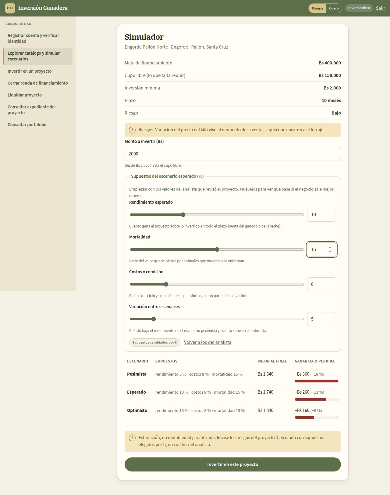
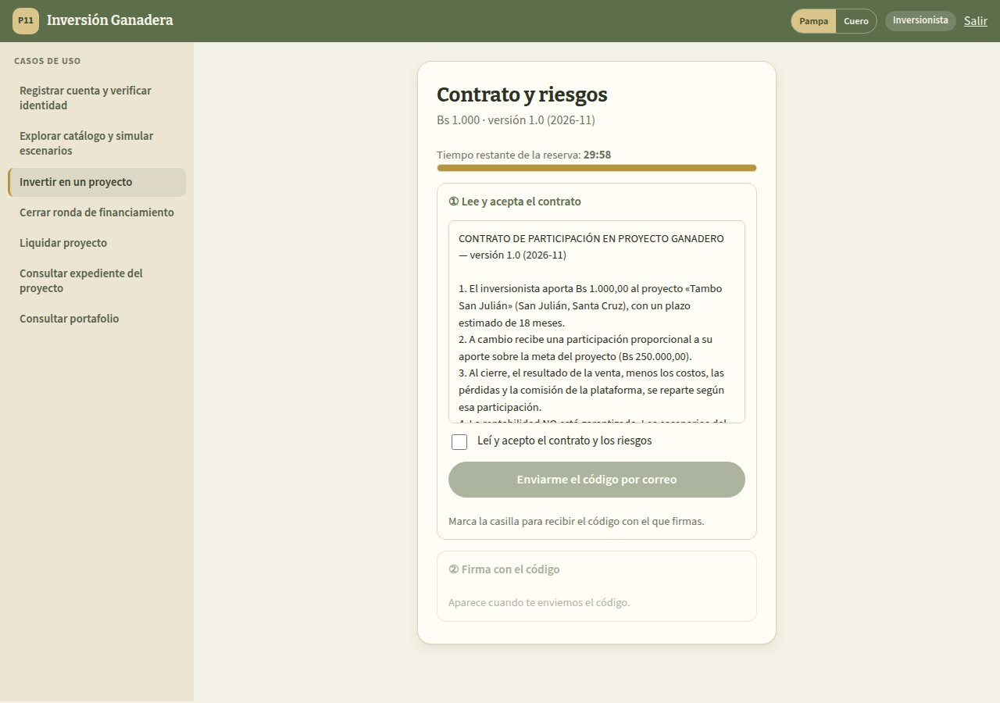
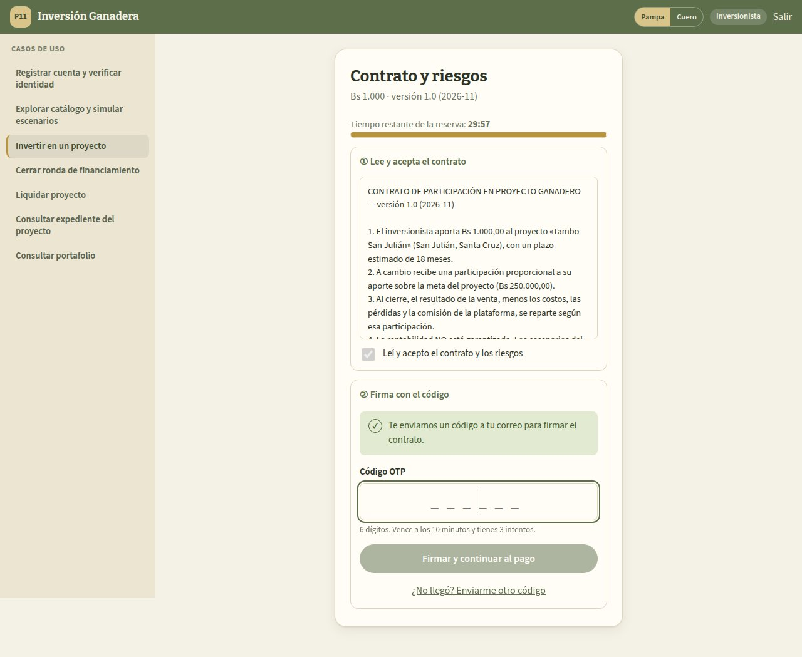
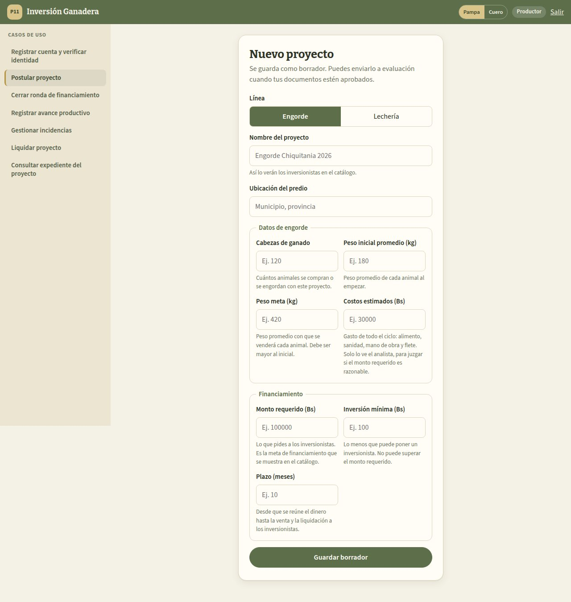

# Correcciones de la defensa del Sprint 2 (25/11/2026)

En la defensa del Sprint 2 sacamos **95/100**. El docente pidió tres mejoras para llegar a 100. Están aplicadas así:

| # | Pedido del docente | Qué cambió | Dónde |
|---|---|---|---|
| 1 | Simulador más libre: que el inversionista juegue con el rendimiento y la mortalidad | El inversionista mueve con deslizadores el rendimiento, la mortalidad, los costos y la variación. Arrancan con los valores del analista y los tres escenarios se recalculan solos. Si algún valor cambió, aparece un aviso y la advertencia lo indica. «Volver a los del analista» los restablece. | `Simulador.jsx`; `POST /api/catalogo/{id}/simulacion` con `rendimientoPct`, `costosPct`, `mortalidadPct` y `variacionPct` opcionales (`SimuladorEscenarios`, el Prototype no cambia) |
| 2 | La casilla de términos no se aplicaba al enviar el OTP | La ventana va por pasos. ① Leer el contrato y marcar «Leí y acepto», que habilita «Enviarme el código». ② El campo del código y «Firmar» aparecen recién cuando el código se envió, y la casilla queda bloqueada. La API también responde 400 si se pide el código sin aceptar. | `Contrato.jsx`; `POST /api/inversiones/{id}/contrato/codigo { aceptaRiesgos }` |
| 3 | «Costos estimados» se confundía con el monto requerido | El campo se queda: lo pide el ERS en RF-07 y figura en el diagrama de clases. Cada campo de la ficha tiene ahora una línea de ayuda. **Costos estimados** = gasto de todo el ciclo, que solo ve el analista. **Monto requerido** = lo que se pide a los inversionistas, la meta del catálogo. También se aclararon los textos del catálogo («Falta reunir» en vez de «Cupo libre», «Inversión mínima hasta») y las ayudas del analista. | `NuevoProyecto.jsx`, `EvaluarProyecto.jsx`, `Catalogo.jsx`, `Invertir.jsx` |

Con el mismo criterio se agregaron ayudas en otras pantallas donde un dato no se explicaba solo:

- **Registro:** «CI» lleva el formato, con complemento después del guion, y «Soy» explica qué hace cada rol según la opción elegida.
- **Documentos del predio:** dice para qué sirve el RUNSA, el título o el contrato de alquiler, según el tipo elegido.
- **Evaluar:** explica qué significa cada nivel de riesgo, que el inversionista ve en el catálogo.
- **Cierre del proyecto:** «Costos reales del ciclo» aclara que se descuentan de la venta y que no son los costos estimados de la ficha.

Pruebas: **121, 0 fallas** (`dotnet test tests/api`). Las 6 nuevas son:

- `CatalogoTests`: supuestos propios, supuestos iguales a los del analista y valores fuera de rango (3 casos);
- `InversionesTests`: sin aceptar no se envía el código.

## Capturas

| | |
|---|---|
|  |  |
| Simulador con supuestos cambiados por el inversionista | Contrato: sin la casilla, el botón está deshabilitado y el paso ② no aparece |
|  |  |
| Contrato: código enviado, casilla bloqueada, campo OTP | Ficha del proyecto con una ayuda bajo cada campo |

## Diagramas

Secuencia y Colaboración pasaron a la **v6** (Brandon), alineadas con el código:

- **CU-05:** el inversionista indica el monto y mueve los supuestos dentro de un `loop`, y el simulador usa los suyos o, si faltan, los del analista. Hay una rama de 400 para un dato fuera de rango.
- **CU-06:** «Aceptar contrato y riesgos» va antes de «Pedir código para firmar», con un `break` 400 si no aceptó; después se ingresa el código y se firma.

Archivos: [`../../diagramas/uml/03-secuencia.mdj`](../../diagramas/uml/03-secuencia.mdj), [`04-colaboracion.mdj`](../../diagramas/uml/04-colaboracion.mdj) y las figuras de CU-05 y CU-06 en `docs/diagramas/figuras/`.
